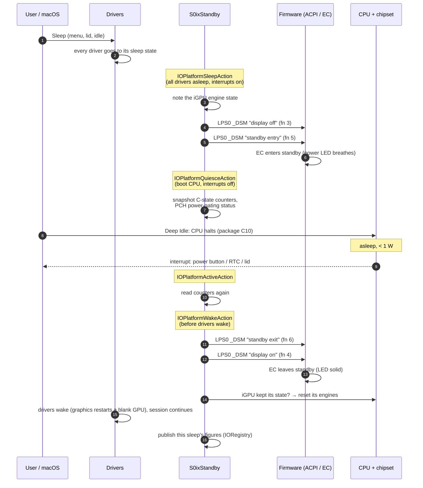

# How S0ixStandby works

A one-page overview. Background and evidence: [RESEARCH-2A.md](RESEARCH-2A.md)
(XNU internals), [FINDINGS.md](FINDINGS.md) (measurements),
[DESIGN.md](DESIGN.md) (design decisions).

## The problem

Modern laptops are built for **Modern Standby (S0ix)**: the system never
really powers down; the CPU and chipset idle so deeply that the laptop draws
well under 1 W. Many of them no longer support the old **ACPI S3**
suspend-to-RAM properly. On the HP EliteBook 840 G8, S3 resume hangs in the
firmware, on Linux as well as on macOS.

macOS sleeps with S3 on PC hardware, so on these laptops sleep either hangs
or (with the usual workaround) becomes a power-off that loses the session.

## The idea

Intel Macs already have an S0 sleep: **Deep Idle**. macOS puts every driver
to sleep as usual, then instead of entering S3 it halts the CPU in its deepest
idle state (XNU `acpi_idle_kernel()`) until an interrupt (power button, RTC
alarm, lid) wakes it. Real Macs switch it on through two small ACPI methods.

S0ixStandby turns that on for PC laptops and adds what PC firmware expects
during Modern Standby.

## The two parts

| Part | Job |
|---|---|
| **`acpi/SSDT-DEEPIDLE.aml`** | Defines `\_SB.LPS0` and `\_GPE.LXEN` (macOS only). AppleACPIPlatform then publishes `IOPMDeepIdleSupported` and macOS sleeps with **Deep Idle** (sleep type 7) instead of S3. *This is what makes the laptop sleep.* |
| **`S0ixStandby.kext`** | Makes Deep Idle behave like Modern Standby on PC firmware: sends the firmware's standby notifications (LPS0 `_DSM`), resets an Intel iGPU at wake when it kept its state (so graphics acceleration survives sleep), measures each sleep, and reports what keeps the platform out of S0ix. Plain IOKit, no Lilu, no patching. |

## What happens during sleep

All four hooks are standard XNU platform actions: the kext only sets a
property, and XNU calls it at those points
(`iokit/Kernel/IOPlatformActions.cpp`, `IOCPU.cpp`). The `_DSM` calls are
made only for Deep Idle sleeps, never for S3.

## What the kext does at boot

1. **Finds the low-power S0 device:** any ACPI device with `_HID`/`_CID`
   `PNP0D80` (every Modern Standby laptop has one).
2. **Asks the firmware what it supports:** `_DSM` function 0 for the Intel,
   Microsoft and AMD variants; only supported functions are ever called.
3. **Finds the S0ix counter** through the ACPI **LPIT** table (address and
   frequency of the SLP_S0 residency counter).
4. **Checks the CPU** (Intel client models only) so it can read the package
   C-state counters safely.
5. **Loads platform data** for the blocker report (Info.plist
   `S0ixPlatforms`, keyed by CPU model; Tiger Lake-LP included).
6. With `-s0ixd3`: after 60 s, puts **PCI devices without any macOS driver**
   in D3hot.
7. **Finds the Intel iGPU** (Gen11/Gen12: Ice Lake to Raptor Lake) and maps
   its registers for the wake-time check.

## Why the GPU reset

With graphics acceleration (e.g. WhateverXe) the iGPU keeps its engine state
through Deep Idle. Apple's graphics driver was written for S3, where the GPU
loses power, so on wake it restarts the engines as if they were blank, on top
of the leftover state, and the driver's bookkeeping breaks (WhateverXe
panicked a few seconds after every wake). At the wake action, before any
driver wakes, the kext checks the GPU and, if it kept its state, resets its
engines (as Linux does on every resume). The display is not touched. Without
an accelerator the GPU is left alone. Details: [FINDINGS.md](FINDINGS.md) §9.

A WhateverXe build with the retained-CSB fix (WhateverXe #203) wakes on the
state Deep Idle kept instead, and publishes `TGLS0SleepHookRouted = Yes` on
the registry root. The kext reads that before each sleep and then skips the
reset (`GPU reset` = `skipped: WhateverXe keeps the retained GT`), so
`-s0ixnogpureset` is no longer needed with such a build.

Nothing is hardcoded per laptop: everything comes from ACPI tables, the CPU
and the platform data.

## What it reports

`macos/s0ix-status.sh` shows it; the raw values are IORegistry properties of
the `S0ixStandby` service.

| Figure | Meaning |
|---|---|
| Sleep type | 7 = Deep Idle (good), 2 = S3 |
| S0ix (SLP_S0) % | Share of the sleep the whole platform spent in S0ix |
| C-states % | How deep the CPU package went (PC10 = deepest) |
| Likely SLP_S0 blockers | Chipset devices still powered when the CPU halted |
| Live blockers | The same, refreshed every 10 s while awake |
| DSM masks, LPIT, MSR 0xE2 | What the firmware and CPU offer |
| GPU state after sleep / GPU reset | Whether the iGPU kept its state, and whether (and how fast) it was reset |
| Battery full state | Read every minute from `IOPMPowerSource`. `stuck` = on AC, not charging, not FullyCharged, within 3 % of full: macOS then dark-wakes every few minutes ([BATTERY-FULL](BATTERY-FULL.md)) |
| Last wake source | PM1 status (PWRBTN, RTC) and GPE0 status bits latched right after the halt, e.g. `PWRBTN` or `GPE 0x6e (EC)`. With `EC GPE at last halt` (whether macOS left the EC's GPE on) and `EC wakes` |
| PM1_EN during halt | PM1_EN at the quiesce action (after macOS armed its wake events) and right after the halt: whether PWRBTN_EN and RTC_EN were on. A `PWRBTN` in `Last wake source` with `PWRBTN_EN OFF` means the press was latched but couldn't wake the CPU |
| Power button | FADT model: fixed feature (wakes through PM1 PWRBTN_EN) or control method (a PNP0C0C device whose `_PRW` GPE must be armed), plus the FADT flags |
| Wake GPEs armed during halt | GPE0 enable bits read right after the halt, before ACPI changes them: the GPEs that could actually wake the machine. AppleACPIPlatform arms them from the devices' `_PRW` after the quiesce actions (#7) |
| Display DMC firmware / at sleep / at wake action | Whether a display microcontroller image is in program RAM, with the raw values. On Tiger Lake only, it also names the image when program[0] and SSP base both match: Apple's built-in (`0x0b004040`, `0x6fc0`) or Intel's `tgl_dmc_ver2_12` (`0x0c004040`, `0x86fc0`). At the wake action the display well is usually still off, so 0 there is expected |
| Recent log | The kext's last 40 log lines (seconds since boot), published after each wake, at start and every minute |
| Since boot (script) | Sleeps, dark wakes and hours asleep since boot, from `pmset -g log` |

## The usual chain to S0ix, and where each step can fail

| Step | Needed for | Check | Typical fix |
|---|---|---|---|
| macOS chooses Deep Idle | any sleep | `IOPMSystemSleepType = 7` | `SSDT-DEEPIDLE` |
| CPU reaches package C10 | low power | `C-states: PC10` high (also `sysctl machdep.xcpm.deep_idle_last_stats`) | Tiger Lake: spoof **Ice Lake**, not Coffee Lake |
| Firmware told about standby | EC / platform low power | LED breathes; `Last DSM entry/exit = Yes` | the kext |
| Chipset devices power-gated | S0ix | blocker list empty | device drivers (e.g. CNVi Wi-Fi/BT) |
| Platform enters S0ix | lowest power | `S0ix %` > 0 | all of the above |

On the HP EliteBook 840 G8 everything up to the fourth row works (0.4.0:
~0.7–1.0 W, Linux S0ix 0.76 W, graphics acceleration across sleep); CNVi
(Intel Wi-Fi/BT) is the remaining blocker.

## Boot-args

| Boot-arg | Effect |
|---|---|
| `-s0ixoff` | don't load (SSDT-only Deep Idle remains) |
| `-s0ixnodsm` | measure only, never call `_DSM` |
| `s0ixfn=<mask>` | only call the listed `_DSM` functions (debugging) |
| `-s0ixd3` | keep driverless PCI devices in D3hot |
| `-s0ixdbg` | verbose log |
| `-s0ixpmcdump` | snapshot the PMC register page at boot and at each halt |
| `-s0ixnocst` | don't read CPU C-state MSRs |
| (default) | Intel Gen11/12 iGPU: at a Deep Idle wake, before any driver wakes, check whether the GPU kept its state and if so reset its engines, so the graphics driver finds the blank GPU it expects. Skipped when the registry root has `TGLS0SleepHookRouted = Yes` (WhateverXe with the retained-CSB fix, read before each sleep) |
| `-s0ixnogpureset` | never reset the GPU |
| `-s0ixgpureset` | enable the wake-time GPU reset on Gen11/12 CPUs other than Tiger Lake (default there: off, untested), and keep it even when WhateverXe reports `TGLS0SleepHookRouted` |
| `-s0ixpwrbtnwake` | at the quiesce action, if PM1_EN.PWRBTN_EN is off: write 1 to PM1_STS.PWRBTN_STS (a stale status would wake at once), set PWRBTN_EN; at the active action put it back off. Only meaningful with a fixed-feature power button (`Power button` property) |
| `-s0ixlanpm` | Deep Idle only, at the sleep action, for each PCI Ethernet function (up to 4): Intel NICs with a memory BAR0 get `CTRL_EXT` (MMIO 0x18) bit 28 `DRV_LOAD` cleared, via a 10 ms D3hot→D0→D3hot if the driver already set D3hot (only with No_Soft_Reset = 1: a reset would wipe the driver's setup); a function left in D0 goes to D3hot with its config header saved; then the bus-master bit is cleared. At the wake action: D0 + header restore if S0ixStandby set D3hot, bus master back on. `DRV_LOAD` is set again from the publish timer once the driver has the NIC in D0 |
| `-s0ixishpm` | once, about 30 s after boot: 00:12.0 (known Intel ISH, no driver attached) to D0, command Mem+BusMaster+INTx-disable, then Linux `ish_hw_start`/`ishtp_start` in polled mode (HOST_READY, RMP2, reset doorbell, `MNG_RESET_NOTIFY` → ACK, wait for `FWSTS` ILUP+ISHTP_READY, HBM start, query subscribers), every step with a bounded poll. At the sleep action: the 20-byte ISHTP `SYSTEM_STATE_STATUS` suspend, wait ≤100 ms for `MNG_RX_CMPL_INDICATION`; at the wake action: resume (`sts=0`). The ISH is excluded from `-s0ixd3` and never set to D3hot |
| Last LPM substates | read-only: S0i2.0 (`PWRM+0x1C80`) and S0i3.0 (`0x1C8C`) residency across the last halt (32 768 Hz), with `LPM_EN`; TGL / ADL / RPL when the SLP_S0 counter is `PWRM+0x193C` |
| (default) AMT SOL D3hot, `-s0ixnosold3` turns it off | Deep Idle only: before the `_DSM` entry, if the Intel serial function at 00:16.3 (AMT SOL, class 0x07) is in D0, save its config header and set PMCSR to D3hot; at wake set D0, wait 10 ms, and restore the BARs, interrupt line and command if the function was reset. `SOL PCI power state` shows the PMCSR before, during and after |
| (default) HPET comparator fix, `-s0ixnohpetfix` turns it off | when the HPET is stopped, set every disabled timer comparator that equals the main counter to `0xFFFFFFFF` (at start, before the `_DSM` entry, at wake); `GEN_CONF` and the counter are left alone. Lets the PMC enter S0i2.0 / SLP_S0 (FINDINGS §14). With `-s0ixnohpetfix` the HPET is only read for `HPET comparator fix` |
| `-s0ixhdapm` | Deep Idle only: before the `_DSM` entry, with 00:1f.3 already in D3hot, set PCI `PGCTL` (0x44) ADSPPGD=0 / LSRMD=1 and OR the `CGCTL` (0x48) clock-gating mask (`s0ixhdacg=`, default `0x003F01FF`); restore both saved values at wake before the drivers. `HDA PCI power state` shows the values |
| `-s0ixwifipm` | experimental: let macOS's PCI layer put the Wi-Fi function into D3 for sleep (as Apple's drivers request), with its ACPI `_PS3` and config restore on wake |
| `-s0ixecwake` | experimental: at the Deep Idle quiesce action (last step before the halt), set the EC's GPE enable bit (EC `_GPE`, GPE0 enable register from the FADT) if macOS left it off. Not cleared again at wake: it is the EC's runtime GPE, which ACPI keeps enabled while awake (`EC GPE now` shows it). A pending EC event (e.g. lid open, `_Q0A` on the HP) is then handled by macOS's ACPI as usual. The EC is found in the ACPI plane (`PNP0C09`, its `_GPE`), retried every minute for 10 min; `s0ixecgpe=0xNN` overrides. **Limitation:** AppleACPIPlatform rewrites the wake GPE set from the devices' `_PRW` after the quiesce actions, so this bit may not survive until the halt; a `_PRW` (e.g. `acpi/SSDT-LIDWAKE`) is the reliable way. `Wake GPEs armed during halt` shows the result |
| `s0ixtrace=0xNN` | diagnostic: at kext start, at the start and end of the sleep action, after the `_DSM` entry, at the quiesce and active actions, at the start and end of the wake action and after publishing, write a stage code (`0xA0`–`0xA8`) to extended-bank CMOS RAM byte `0xNN` (`0x80`–`0xFF`, ports 0x72/0x73; the standard bank only with `-s0ixtraceforce`, since firmware checksums it). At start the previous value is read and published as `Sleep trace`. See [SLEEP-TRACE](SLEEP-TRACE.md) |
| `-s0ixacnortc` | experimental: while on AC (IOPMPowerSource `ExternalConnected`, cached every 10 s), clear the RTC's alarm interrupt enable (CMOS register B AIE) and the ACPI `RTC_EN` (PM1_EN bit 10, PM1a event block from the FADT) at the Deep Idle sleep action, `RTC_EN` again at the quiesce action; both restored first thing at the wake action. No RTC dark wakes on AC |
| `-s0ixrefclk` | experimental: i915's Wa_14010685332 for Deep Idle: `SOUTH_CHICKEN1` (iGPU MMIO 0xC2000) bit 7 set at the sleep action when the display core is down (DC9, power wells off), cleared at the wake action |
| `-s0ixgpuprobe` | debugging: also probe an idle GPU and keep the last result in NVRAM (`nvram s0ix-gpu-last`, survives a panic) |

## What it does not do

- It doesn't make the laptop sleep: the SSDT does.
- It doesn't patch macOS or any driver, and doesn't change how drivers sleep.
  (`-s0ixgpureset` resets the GPU *hardware* at wake, before its driver runs;
  the driver itself is untouched.)
- It doesn't force a sleep state: if macOS picks S3, the kext does nothing.
- It can't power down devices whose drivers keep them on: that's a driver fix.
