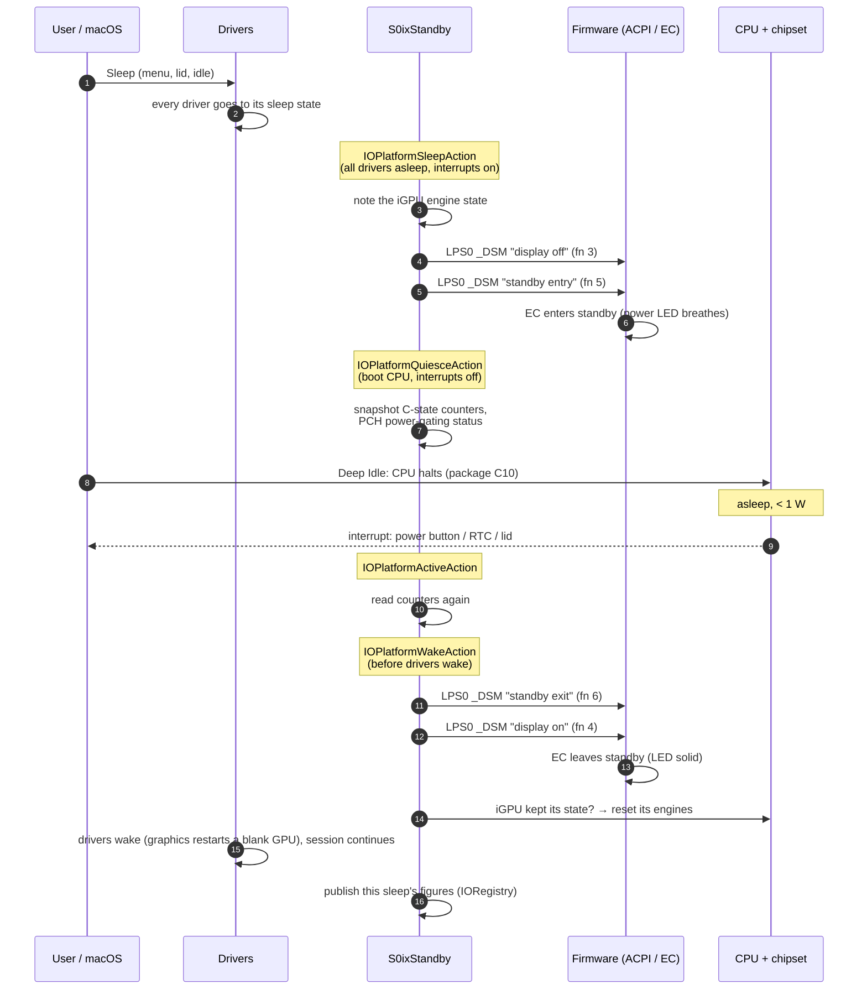

# How S0ixStandby works

A one-page overview. Background and evidence: [RESEARCH-2A.md](RESEARCH-2A.md)
(XNU internals), [FINDINGS.md](FINDINGS.md) (measurements),
[DESIGN.md](DESIGN.md) (design decisions).

## The problem

Modern laptops are built for **Modern Standby (S0ix)**: the system never
really powers down; the CPU and chipset idle so deeply that the laptop draws
well under 1 W. Many of them no longer support the old **ACPI S3**
suspend-to-RAM properly. On the HP EliteBook 840 G8, S3 resume hangs in the
firmware, on Linux as well as on macOS.

macOS sleeps with S3 on PC hardware, so on these laptops sleep either hangs
or (with the usual workaround) becomes a power-off that loses the session.

## The idea

Intel Macs already have an S0 sleep: **Deep Idle**. macOS puts every driver
to sleep as usual, then instead of entering S3 it halts the CPU in its deepest
idle state (XNU `acpi_idle_kernel()`) until an interrupt (power button, RTC
alarm, lid) wakes it. Real Macs switch it on through two small ACPI methods.

S0ixStandby turns that on for PC laptops and adds what PC firmware expects
during Modern Standby.

## The two parts

| Part | Job |
|---|---|
| **`acpi/SSDT-DEEPIDLE.aml`** | Defines `\_SB.LPS0` and `\_GPE.LXEN` (macOS only). AppleACPIPlatform then publishes `IOPMDeepIdleSupported` and macOS sleeps with **Deep Idle** (sleep type 7) instead of S3. *This is what makes the laptop sleep.* |
| **`S0ixStandby.kext`** | Makes Deep Idle behave like Modern Standby on PC firmware: sends the firmware's standby notifications (LPS0 `_DSM`), resets an Intel iGPU at wake when it kept its state (so graphics acceleration survives sleep), measures each sleep, and reports what keeps the platform out of S0ix. Plain IOKit, no Lilu, no patching. |

## What happens during sleep

All four hooks are standard XNU platform actions: the kext only sets a
property, and XNU calls it at those points
(`iokit/Kernel/IOPlatformActions.cpp`, `IOCPU.cpp`). The `_DSM` calls are
made only for Deep Idle sleeps, never for S3.

## What the kext does at boot

1. **Finds the low-power S0 device:** any ACPI device with `_HID`/`_CID`
   `PNP0D80` (every Modern Standby laptop has one).
2. **Asks the firmware what it supports:** `_DSM` function 0 for the Intel,
   Microsoft and AMD variants; only supported functions are ever called.
3. **Finds the S0ix counter** through the ACPI **LPIT** table (address and
   frequency of the SLP_S0 residency counter).
4. **Checks the CPU** (Intel client models only) so it can read the package
   C-state counters safely.
5. **Loads platform data** for the blocker report (Info.plist
   `S0ixPlatforms`, keyed by CPU model; Tiger Lake-LP included).
6. With `-s0ixd3`: after 60 s, puts **PCI devices without any macOS driver**
   in D3hot.
7. **Finds the Intel iGPU** (Gen11/Gen12: Ice Lake to Raptor Lake) and maps
   its registers for the wake-time check.

## Why the GPU reset

With graphics acceleration (e.g. WhateverXe) the iGPU keeps its engine state
through Deep Idle. Apple's graphics driver was written for S3, where the GPU
loses power, so on wake it restarts the engines as if they were blank, on top
of the leftover state, and the driver's bookkeeping breaks (WhateverXe
panicked a few seconds after every wake). At the wake action, before any
driver wakes, the kext checks the GPU and, if it kept its state, resets its
engines (as Linux does on every resume). The display is not touched. Without
an accelerator the GPU is left alone. Details: [FINDINGS.md](FINDINGS.md) §9.

Nothing is hardcoded per laptop: everything comes from ACPI tables, the CPU
and the platform data.

## What it reports

`macos/s0ix-status.sh` shows it; the raw values are IORegistry properties of
the `S0ixStandby` service.

| Figure | Meaning |
|---|---|
| Sleep type | 7 = Deep Idle (good), 2 = S3 |
| S0ix (SLP_S0) % | Share of the sleep the whole platform spent in S0ix |
| C-states % | How deep the CPU package went (PC10 = deepest) |
| Likely SLP_S0 blockers | Chipset devices still powered when the CPU halted |
| Live blockers | The same, refreshed every 10 s while awake |
| DSM masks, LPIT, MSR 0xE2 | What the firmware and CPU offer |
| GPU state after sleep / GPU reset | Whether the iGPU kept its state, and whether (and how fast) it was reset |

## The usual chain to S0ix, and where each step can fail

| Step | Needed for | Check | Typical fix |
|---|---|---|---|
| macOS chooses Deep Idle | any sleep | `IOPMSystemSleepType = 7` | `SSDT-DEEPIDLE` |
| CPU reaches package C10 | low power | `C-states: PC10` high (also `sysctl machdep.xcpm.deep_idle_last_stats`) | Tiger Lake: spoof **Ice Lake**, not Coffee Lake |
| Firmware told about standby | EC / platform low power | LED breathes; `Last DSM entry/exit = Yes` | the kext |
| Chipset devices power-gated | S0ix | blocker list empty | device drivers (e.g. CNVi Wi-Fi/BT) |
| Platform enters S0ix | lowest power | `S0ix %` > 0 | all of the above |

On the HP EliteBook 840 G8 everything up to the fourth row works (0.4.0:
~0.7–1.0 W, Linux S0ix 0.76 W, graphics acceleration across sleep); CNVi
(Intel Wi-Fi/BT) is the remaining blocker.

## Boot-args

| Boot-arg | Effect |
|---|---|
| `-s0ixoff` | don't load (SSDT-only Deep Idle remains) |
| `-s0ixnodsm` | measure only, never call `_DSM` |
| `s0ixfn=<mask>` | only call the listed `_DSM` functions (debugging) |
| `-s0ixd3` | keep driverless PCI devices in D3hot |
| `-s0ixdbg` | verbose log |
| `-s0ixpmcdump` | snapshot the PMC register page at boot and at each halt |
| `-s0ixnocst` | don't read CPU C-state MSRs |
| (default) | Intel Gen11/12 iGPU: at a Deep Idle wake, before any driver wakes, check whether the GPU kept its state and if so reset its engines, so the graphics driver finds the blank GPU it expects |
| `-s0ixnogpureset` | never reset the GPU |
| `-s0ixgpureset` | enable the wake-time GPU reset on Gen11/12 CPUs other than Tiger Lake (default there: off, untested) |
| `-s0ixwifipm` | experimental: let macOS's PCI layer put the Wi-Fi function into D3 for sleep (as Apple's drivers request), with its ACPI `_PS3` and config restore on wake |
| `-s0ixacnortc` | experimental: while on AC (IOPMPowerSource `ExternalConnected`, cached every 10 s), clear the RTC's alarm interrupt enable (CMOS register B AIE) and the ACPI `RTC_EN` (PM1_EN bit 10, PM1a event block from the FADT) at the Deep Idle sleep action, `RTC_EN` again at the quiesce action; both restored first thing at the wake action. No RTC dark wakes on AC |
| `-s0ixrefclk` | experimental: i915's Wa_14010685332 for Deep Idle: `SOUTH_CHICKEN1` (iGPU MMIO 0xC2000) bit 7 set at the sleep action when the display core is down (DC9, power wells off), cleared at the wake action |
| `-s0ixgpuprobe` | debugging: also probe an idle GPU and keep the last result in NVRAM (`nvram s0ix-gpu-last`, survives a panic) |

## What it does not do

- It doesn't make the laptop sleep: the SSDT does.
- It doesn't patch macOS or any driver, and doesn't change how drivers sleep.
  (`-s0ixgpureset` resets the GPU *hardware* at wake, before its driver runs;
  the driver itself is untouched.)
- It doesn't force a sleep state: if macOS picks S3, the kext does nothing.
- It can't power down devices whose drivers keep them on: that's a driver fix.
